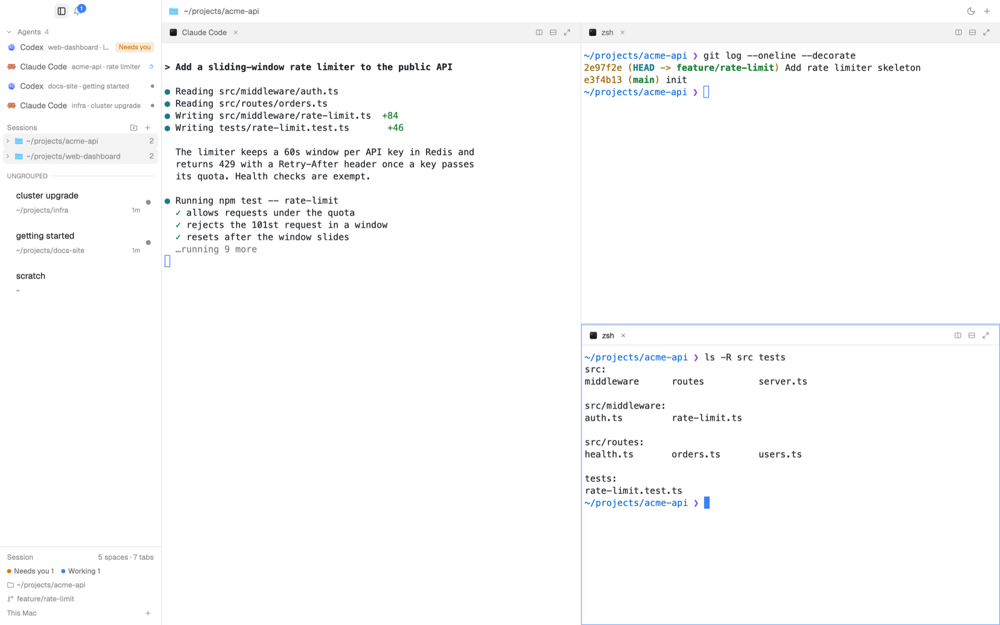

# Hmux

A terminal-first Herdr layout with a fixed, glassy sidebar: agents and their
sub-agents on top, then folders and their sessions, then a session footer with
your working folder, branch, machines and how many agents need you. The whole
window follows a light and a dark theme, switched from the title bar with a
crossfade instead of a hard cut.



Built for macOS (the title bar leaves room for the traffic lights and the
folder menu uses Finder and `pbcopy`).

## What you get

- **Title bar (32px):** sidebar toggle, notification bell with an unread badge,
  the current space · session, sun/moon theme switch, new session. The window
  drags by this bar; a double-click maximizes.
- **Sidebar (232px, resizable 180–380px):**
  - **Agents** — every agent with its program icon and status. Pinned agents
    stay on top, then by urgency: needs you, done, working, idle. Sub-agents
    are nested under the agent that started them (three levels).
  - **Tabs** — your local folders. Click a folder to fold or unfold it (it never
    switches space); click a session to go there. A session shows how long its
    agent has been working (`now`, `4m`, `2h`), its splits and its status.
  - **Session** — status counts, the focused pane's folder and branch, and
    `This Mac + N` which folds open into your SSH machines, their spaces and
    sessions.
- **Panes:** a 20px header with the program, folder, branch and status; on
  hover, split right/down, zoom and close.
- **Right-click:** rename, reset the name, split, reveal in Finder, copy the
  path, new worktree, close — sessions, folders and agents each have their own
  menu. Closing asks first.
- **Drag to reorder:** grab a folder or session and it lifts; the rows spring
  aside live and the drop lands where the preview showed it.
- **Theme crossfade:** the sun/moon button takes a picture of the window, flips
  the theme underneath and fades the picture out in 0.7s. Reduce Motion is
  respected.
- **Notifications:** agents that turn "needs you" or "done" land in the bell's
  popup; click one to jump to that agent. The list is kept for the session.

## Install

Hmux is a folder laid out like `~/.config/herdr-app`:

```sh
git clone https://github.com/cuqe/Hmux.git
cd Hmux
cp layouts/hmux.json layouts/hmux.svg ~/.config/herdr-app/layouts/
cp -R mods/hmux ~/.config/herdr-app/mods/
cp themes/hmux-white.json themes/hmux-black.json ~/.config/herdr-app/themes/
herdr-app do layout.switch --name hmux
```

Herdr reloads mods live. Switch back with `ctrl-shift-l`; delete the files to
remove it. The layout needs the mods Herdr ships (`workspace-chrome`, `pane`,
`worktree`) for its icons and the New worktree dialog.

## Customize

- `themes/hmux-white.json` and `themes/hmux-black.json` hold every color.
- Sizes live in `layouts/hmux.json` (sidebar 232px, title bar 32px, pane header
  20px) and in `mods/hmux/main.js` (`ROW = 22`).
- Motion durations and springs are tokens in `mods/hmux/motion.js`.

## License

MIT — see `LICENSE`. The five icons in `mods/hmux/*.svg` are Lucide icons
(ISC, with three derived from Feather, MIT); see `THIRD_PARTY_NOTICES.md`.
