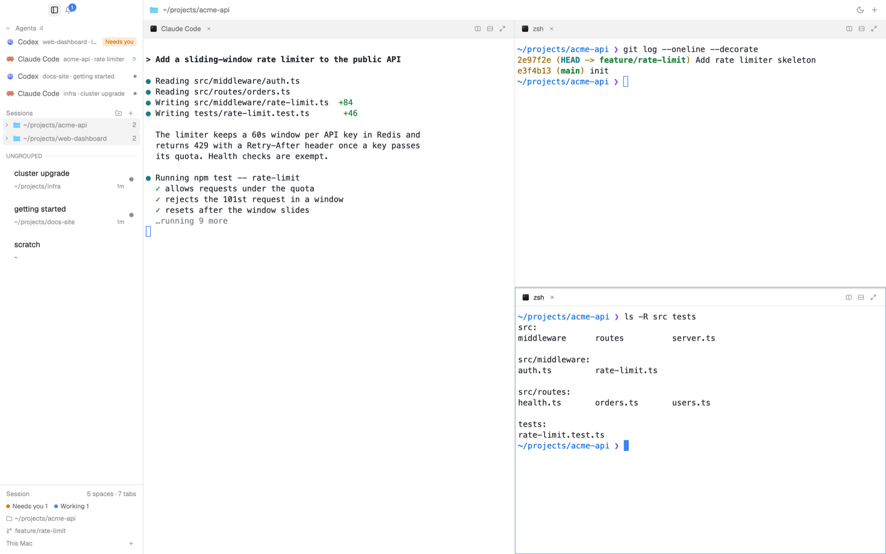

# Hmux

A terminal-first Herdr layout: a fixed 232px glass sidebar on the left, a
full-width 32px title bar above everything, and the active tab's panes filling
the rest. The sidebar stacks agents (with their sub-agents), then sessions —
each a roomy two-line row, filed into groups you make yourself — then a session
footer with folder, branch and SSH machines. Two themes (white, black) follow
the system appearance and crossfade when you press the sun/moon button, instead
of cutting.

## What you see

Top to bottom, left to right.

**Title bar — 32px tall, full width.** A block with `window_drag: true` and the
theme's `glass` background. It starts 78px from the left so the macOS window
buttons sit in it. Buttons are 12px icons with 4px padding in 5px rounded
corners, drawn in `dim` and turning `foreground` + `hover` background on hover,
one slightly lighter background when active.

The strip above the sidebar (`sidetop`) holds the sidebar toggle
(`layout.toggle`) and the bell with its count badge (a 13px accent circle,
8.5px semibold `accent_foreground`, up to `9+`) — cmux's top-left, with the
traffic lights over it. With the sidebar hidden the title bar carries both.
- The session's folder: the macOS folder icon at 14px and the focused pane's
  working path (`~/…`, 11.5px `muted`, capped 300px), then empty space. The
  title bar lives in the work column, so it starts exactly at the body's
  divider — there is no line of its own. With the sidebar hidden it starts at
  the window edge with an 88px inset for the traffic lights.
- Sun (in the dark theme) or moon (in the light theme) — the theme button.
- `+` — new session in the current space (`tab.new`).

**Sidebar — 232px, resizable between 180 and 380px.** `glass` background, a 1px
`edge` divider on its right, 12px text. It scrolls (a slim scrollbar) except
the Session footer, which stays pinned at the bottom.

- **Agents** header: a 10px chevron, `Agents`, and the count at 70% opacity,
  in 10.5px semibold `dim`; clicking the chevron folds the whole section.
- **Agent rows — 28px tall**, one line: 4px side margin, 6px inner padding,
  5px rounded. Program icon 13px, an optional 9px accent pin, the name at
  11.5px (`foreground` focused, `muted` otherwise, capped 140px), then
  `space · session` at 10px `dim` filling the rest. A blocked agent carries a
  `Needs you` chip (15px tall, `blocked` at 15%, 9.5px semibold); otherwise a
  9px status mark: a spinning ring (800ms per turn) while working, a 6px dot
  for done and idle.
- **Sub-agent rows — 22px**, indented 10px per level (up to three levels),
  with a small elbow (8×10px, `input` colored left+bottom border); 11px
  `muted` name, 11px icon, 8px status mark. Right-click either kind for Go to
  agent, Pin/Unpin / Open in new tab, Peek, and **Delete agent** (asks, then
  `terminal.kill`).
- **Sessions** header: the `Sessions` title, then two 11px icon buttons at its
  right — `folder-plus` (make a group) and `+` (make a session).
- **Group header rows — 22px**, 4px side margin, 5px rounded, a 5% `foreground`
  wash so groups read as containers: a 10px chevron, an 11px folder icon, the
  name at 12px semibold `muted`, and its session count when folded. While a
  session is dragged over one, the header turns `selected` with a 1px accent
  border.
- **Auto group rows — 22px**, the same 5% `foreground` fill as a manual group,
  a 10px chevron, the macOS folder icon at 12px, then the path (`~/…`, plus
  ` · machine` off this Mac) at 11px `dim`. They appear by themselves when two
  or more sessions on the same machine work in the same folder, and fold like
  any other group. (A manual group's name is 12px semibold `muted`; the path
  here is lighter, which is the tell.)
- **Machine groups.** Every session on an SSH machine — including the
  `login <machine>` tab that opened it — groups under the machine's name with a
  server icon, always shown (even with one session) and placed at the bottom of
the Sessions list, so a new remote terminal never falls into `UNGROUPED`.
Local sessions keep their folder groups.
- **The `UNGROUPED` rule** — a 9.5px semibold `dim` label followed by a 1px
  `border` line, shown only when some groups exist above; the sessions under it
  are in no group.
- **Session rows — 58px tall**, 4px side margin, 12px left padding, 8px rounded.
  Line one: the session's name (12.5px semibold, `foreground`; the focused one
  is `accent_foreground`), truncated. Line two: the folder it works in (`~/…`,
  10.5px `dim`, fallback `~`), then `2 splits` when split, the elapsed working
  time (`now`, `12m`, `3h`, `2d`) and the status mark takes the right edge,
  larger than elsewhere (a 14px spinner while working, 8px dots). Hovering the
  row swaps that mark for an 18px circle with a × in the same spot; it asks,
  then closes the session. The active session is filled with the theme accent,
  name and folder turn white (folder at 80% opacity), and the status mark keeps
  its meaning: white spinner, yellow blocked, light green done, half-white idle.
- **Session footer.** 10.5px `dim` text, top border. A `Session` title with
  `N spaces · M tabs` on the right; one chip per status present (6px dot +
  `Working 3`); then the focused pane's folder as `~/…` with a folder icon and
  its branch with a git-branch icon; then the machine fold: `This Mac + 2
  machines · 1 offline`, with a 10px `+` at its right that opens Settings →
  Machines. Opened, it lists each machine (22px row) with a server icon, its
  name, a 6px state dot and a word: Connected (done color), Connecting
  (working), Offline (idle). Clicking an offline machine opens a `login <name>`
  session running `hc machine login <name>` so its password or code can be
  typable there; clicking a connected one selects its first space (or makes one
  when it has none). Open a machine to list **its sessions under it** (each
  22px row: title, path, status; click to `space.select` + `tab.select`, plus
  the `login <machine>` tab, each with a hover × that closes it), with a
  `Connect…` row when offline. The machine row ends in a state dot and a `+`
  that makes a new space (`space.new {machine}`) — the old `Connected` word and
  the `Open` action are gone. Right-click for Connect (offline), New space
  (`space.new {machine}`) and
  `Forget machine` (`hc machine rm <name>` through the confirm dialog's exec
  form — Herdr has no offline toggle, so this forgets the machine while its
  terminals keep running).

**Pane tabs — 30px, one bar per pane.** The macOS Terminal icon, the title,
a close ×, then split-right, split-down and zoom. The focused pane is the page
color with a 2px accent line along its top; the others sit on `chrome`. The
session's folder is in the title bar, like cmux.

**Moving a pane.** Panes drag with the app's native grip on a pane's top edge
(the smooth accent overlay comes from the app itself), and the layout keeps
`movable` at its default. For a click-only path, right-click a pane tab for
Focus, Move left/right/up/down (`pane.focus` + `pane.swap`) and Close pane.

**Panes.** A 1px gap between panes, square corners, the `background` theme
color; the focused pane gets a 1px `focusring` border. Each pane carries its
own 30px tab bar along the top, cmux-style: the terminal glyph (`>_`, 11px),
the program/title (11px medium, capped 220px), a close ×, empty space, then
split-right, split-down and zoom buttons. The focused pane's bar is the page
color with a 2px accent line along its top; the others sit on `chrome`. There
is no second header row.

## How it behaves

**Sessions are not tied to Herdr's folder spaces.** They are Herdr tabs, listed
across every machine, and ordered by the mod's own groups (a display concept).
Selecting a session selects its space and then its tab — on an SSH machine the
same click crosses machines. The row's folder line is the tab's working folder,
not the space's name.

**Automatic folder groups.** Two or more sessions on the same machine whose
working folder is the same form an auto group. It is derived on every render
from the panes' live `cwd`: start or close a session, or `cd` one, and it
appears, dissolves or moves by itself. A manual group always wins: assign the
session and it stays there. Auto group headers take no drops (nothing to
assign); they fold like manual groups.

**Agent status.** Working: a spinning ring, `working` color. Blocked: the
`Needs you` chip (and the tag in the pane header), a `blocked` dot, sorted above
everything except pinned agents. Done: a `done` dot; Herdr turns it idle once
the person looks at it. Idle: a 5px `idle` dot. The sort is pinned first, then
blocked > done > working > idle, then most recent. The sidebar asks Herdr to
keep agent navigation in this same order (`setAgentOrder`).

**Clicks and menus.** Session row: click goes there (`space.select` then
`tab.select`); double-click renames it in place; right-click offers Go to
session, Rename, Reset name (only when named), Split right, Split down, Close
session (which asks, then `tab.close` confirmed). Group row: click folds or
unfolds it; double-click renames it; right-click offers Rename group
and Delete group. A group's delete removes the group only — its sessions stay
as loose sessions. Agent row: click focuses it (`agent.focus`); right-click
offers Go to agent, Pin/Unpin (`terminal.pin`), Peek (`terminal.peek`) and
Delete agent (asks, then `terminal.kill`). Sub-agent: Go to agent, Peek, Open
in new tab (`terminal.keep`, `place: tab`), Delete agent.
Title-bar buttons: sidebar toggle, bell (popup), sun/moon (crossfade), `+`
(new session). Pane header buttons: split (`pane.split`), zoom (`pane.zoom`),
close (`pane.close`); clicking the header focuses the pane.

**Making things.** `+` in the Sessions header (and in the title bar) runs
`tab.new` at once: a fresh session in the active space, never a folder picker,
and it starts ungrouped at the end of the list. `folder-plus` appends a group
(`Group N`) and opens its name for typing right away: Enter or clicking away
saves, Escape cancels.

**Drag and drop.** Press a session and travel 4px: it lifts (`raised`
background, medium shadow, 1px accent border, nudged up 2px) and follows the
pointer. Within its own list the other rows spring aside live (smooth spring) to
show where it will land; release saves the new order. Move it over a **group
header** and that header highlights (`selected` background, accent border);
release there files the session into that group at the end. Move it over the
**Sessions** header (the header above the loose list) to take it out. Releasing
outside the sidebar cancels. The preview is held until the new order settles
(fallback 1200ms), so nothing slides back.

**Rename.** Inline: the row turns into a text field pre-filled with the current
name (no placeholder), focused after 30ms. Enter or clicking away saves, Escape
cancels. An unchanged name is not written, so an auto name keeps following its
agent.

**Theme crossfade.** Press the sun/moon. The mod takes `herdr-app shot` of the
window into `.cache/hmux/`, opens a borderless window overlay (`kind: "window"`,
`frame: "none"`, `key: "hmux-fade"`, at 0,0) with the picture at the window's
size — the title bar's width divided by `settings().zoom`, height from
`window.json` bounds aspect — flips `settings.json`'s `appearance` underneath
(after 120ms), waits 180ms for the new theme to draw, then fades the picture's
opacity to 0 over 700ms ease-in-out and deletes it. While fading, further
presses are ignored. If Reduce Motion is on (`defaults read
com.apple.universalaccess reduceMotion`) or the shot fails, it just writes the
appearance.

**Notifications.** The title bar watches agent statuses. The first render seeds
without posting. Every later change into blocked or done appends
`{id, address, status, title, where, icon, tint, at}` to the shared list
(capped at 60), newest first. The bell shows the number newer than
`hmux.inboxSeen` (set when the popup opens). The popup (320×380 plus an 8px
tail, drawn with `frame: "none"`: a 12px-rounded page, 1px `border`, large
shadow, and a 9px tail over its top edge pointing at the bell — a
`popover`-filled tail with a 1px `border` stroke drawn along its curve, so the
outline reads as one clean line) has a 44px header — `Notifications` at 13px
semibold, an 18px accent count badge, and a 26px `Clear all` pill
(`foreground` at 8%). Each row is 8px/10px padding with
three lines and the **agent's program logo** at 16px on the left (no accent
bar): the title (12.5px semibold) with the time (11px `dim`) at the right,
`space · session` (11px `dim`), then `Needs your input.` / `Finished its
work.` (11px `dim`). Hovering fills the row with `hover` and puts an 18px
circle with a × at the right, vertically centered — the 18px column is
reserved even when hidden, so the time never shifts; that × removes just the
entry. Clicking a live entry jumps to the agent, an
ended one says `· ended`. Empty: `No new notifications.` and `When an agent
finishes or needs you, it shows up here.`

**Motion.** Tokens only (no ms values in components): 120ms fast, 200ms base,
320ms slow, 700ms theme fade; springs snappy (237ms, ζ0.945), smooth
(314ms, ζ0.9), gentle (424ms, ζ0.944); spinner loop 1000ms (the macOS-style
12-spoke wheel). Everything collapses to instant (or opacity-only 120ms) under
Reduce Motion. Elapsed labels refresh every 30s; nothing else polls.

## Built from

**Layout `layouts/hmux.json`** — root `column` with one `body` row (divider
1px `border` — the layout's only vertical line):

- root look: `theme {light: "hmux-white", dark: "hmux-black"}`, font Menlo 13px,
  ui font Geist, `terminal_padding [4,6]`, `titlebar "none"`,
  `traffic_lights [12,10]`, background gradient `[wash_top, wash_bottom]` at
  160°, `preview "layouts/hmux.svg"`.
- `body` — `row`, 1px `border` divider, two children:
  - `sidebar` — `column`, 232px, min 180, max 380, background `glass`:
    - `sidebar-top` — `block`, 32px, `window_drag: true`, background `glass`,
      `content {mod: "hmux", props: {role: "sidetop"}}` (the toggle and bell;
      the traffic lights sit over it).
    - `sidebar-body` — `block`, `{mod: "hmux", props: {role: "sidebar"}}`.
  - `work` — `column`, `resizable: false`:
    - `titlebar` — `block`, 32px, `window_drag: true`, background `glass`,
      `content {mod: "hmux", props: {role: "top"}}`.
    - `main` — `block`, background `hairline`, `content`:
      `{tab: "active", pane: {gap: 1, radius: 0, background: "background",
      lone: true, border {width: 0}, focus {width: 1, color: "focusring"},
      header {content: {mod: "hmux", props: {role: "pane"}}, height: 30,
      position: "top", reveal: "always"}}}`.

The body row's divider is the single vertical line: the title bar lives inside
the work column, so nothing else draws a line.

**`mods/hmux`** — one View class with nine roles read from
`props().role`: `top`, `sidetop`, `spacer`, `sidebar` (default), `pane`,
`inbox`, `menu`, `confirm`, `fade`. It imports `View, div, svg, image` from `gpui-kit`, `v_flex, h_flex,
InputState, Input` from `gpui-base`, and from `herdr`: `agents, spaces, panes,
focused, machines, terminals, props, run, theme, settings, appHome,
readTextFile, writeTextFile, notify, shared, setShared, openOverlay,
closeOverlay, exec`. `motion.js` holds the tokens and the Reduce Motion read.

State: `hmux.groups` (`[{id, name}]`), `hmux.groupOf` (`{tabId: groupId}`),
`hmux.order` (`{u: [tabId…], <groupId>: [tabId…]}`), `hmux.sidebarW` (the
sidebar's measured width), `hmux.inbox`, `hmux.inboxSeen`, `hmux.rename`
(shared) and `expanded` (localStorage: which groups, spaces and
machines are folded). Constants: `ROW = 22` (header rows), `SESSION_H = 58`
(session rows), `DRAG_START = 4`, inbox 320×380 (header 44), menu 200×300,
confirm 360×170.

Commands it runs: `layout.toggle`, `tab.new`, `space.select`, `tab.select`,
`space.move`, `tab.move`, `tab.rename`, `space.rename`, `tab.close`,
`space.close` (both `confirmed: true`), `agent.focus`, `terminal.pin`,
`terminal.peek`, `terminal.keep`, `pane.split`, `pane.zoom`, `pane.close`,
`pane.focus`, `app.settings` (the machine `+` opens `{section: "machines"}`) and
the machine Disconnect's `exec("hc", ["machine", "rm", name])`. The confirm
dialog runs either a `run` command or an `exec`.
Overlays: `hmux` (menu popup, confirm dialog, inbox popup, fade window
`frame: "none"`), and the shipped `worktree` dialog (440×260) for New worktree.

Programs it starts through `exec`: `herdr-app shot` (cover), `mkdir -p` and
`rm -f` (the snapshot folder), `open` (Reveal in Finder), `sh -c printf |
pbcopy` (Copy path), `defaults read com.apple.universalaccess reduceMotion`.
Nothing touches the network.

Icons: `workspace-chrome` (plus, spinner, git-branch, folder, pin,
chevron-right/down), `pane` (split-right/down, zoom, unzoom, close) — all
shipped with Herdr. The mod's own icons (`bell`, `sun`, `moon`, `sidebar`,
`server`, `folder-plus`, `link`, `terminal`) are Lucide; `spinner-macos.svg`
and `popover-tail.svg` are original; `folder-macos.png` is Apple's system
artwork. See THIRD_PARTY_NOTICES.md.

Themes `hmux-white.json` / `hmux-black.json`: full `ansi` + `colors`. White —
background `#ffffff`, canvas `#f5f5f5`, chrome `#f2f2f2`, accent `#3b82f6`,
blocked `#d97706`, done `#28a745`, idle `#8e8e93`, glass `#ffffff` (opaque,
no tint), edge `#00000012`, wash `#ffffff`→`#ffffff` (flat). Black —
background `#1a1a1e`, canvas `#141417`, chrome `#1f1f24`, accent `#0a84ff`,
blocked `#ff9f0a`, done `#30d158`, glass `#1e1e23`, edge `#ffffff14`, wash
`#1a1a1e`→`#1a1a1e`.

## Watch out

- **Groups are display-only.** They are not Herdr spaces and never move a tab
  between spaces; a session keeps living in the space it was made in. Dragging
  inside a group changes only `hmux.order` (Herdr's own tab order is left
  alone), so `tab.next`/`prev` follow Herdr, not the sidebar.
- **Sessions are listed across all local spaces.** Closing a space closes its
  tabs; their rows and group entries disappear. Stale ids in `hmux.order` are
  harmless (they are filtered out on render).
- **macOS first.** 78px title-bar inset and `traffic_lights [12,10]` assume
  macOS buttons; Reveal in Finder (`open`), Copy path (`pbcopy`) and the Reduce
  Motion read (`defaults`) are macOS-only.
- **Icons come from shipped mods.** `mods/workspace-chrome/*.svg` and
  `mods/pane/*.svg` must exist; a Herdr version that renames them leaves blank
  icons. Bundle copies if that matters.
- **Both themes must be installed.** `glass`, `hairline`, `edge`, `focusring`,
  `wash_top`, `wash_bottom` are custom color names — without
  `themes/hmux-*.json` they fall back to the built-in themes and the layout
  loses its look.
- **Row height is a constant.** Session rows use `SESSION_H` (58px); group
  headers, agent rows, machine rows and the session bar use their own heights.
  Changing a height without its constant misaligns drags.
- **The active session has no overlay:** the row itself is accent-filled (the
  old sliding highlight was removed). The status mark keeps its meaning there:
  a white spinner, a yellow blocked dot, a light green done dot, a half-white
  idle dot.
- **Auto groups are derived, never stored.** They exist only while two or more
  sessions share a machine + folder; their fold state is the only thing kept
  (`a:<machine>|<folder>`). They take no drops, because membership follows the
  folder. A manual group always wins over one.
- **The Sessions list includes SSH machines.** A session row's folder is its
  pane's `cwd`, so a remote session shows its remote path; clicking one selects
  that machine's space and tab. The footer's machine list is status only.
- **Fold state** lives in localStorage `expanded`: a folded Agents section is
  `agents:off`, a folded group `g:<id>`, machines `m:*`.
- **The session × appears on hover**, in the status mark's place; the mark
  returns when the pointer leaves. Pane tabs keep their own ×. The notification
  × is also hover-only, and the inbox draws its own frame (`frame: "none"`), so
  its 8px tail sits above the panel — keep that extra height in `openInbox`.
- **Offline machine click** opens a `login <name>` session running
  `hc machine login <name>`; type the password or code in that terminal. It
  needs `hc` on the login shell's PATH (Herdr installs it there).
- **Notification delete is hover-only** (`inboxHover`); the row × does not
  focus the agent, it only drops the entry.
- **The folder icon** in the title bar is Apple's system artwork
  (`folder-macos.png`); see THIRD_PARTY_NOTICES.md.
- **One vertical line.** The body row's divider is the only line between the
  sidebar and the work column; the title bar sits inside the work column and
  draws none. `hmux.sidebarW` still tracks the sidebar for the fade cover.
- **Move beside uses tab order.** A drop calls `pane.swap` left/right by the
  tabs' order, which is exact for side-by-side splits; for a stacked split use
  the tab's right-click Move up/down. `pane.swap` is geometric, so a very
  unusual tree may land differently.
- **Forget, not disconnect.** Herdr exposes no offline toggle for a machine:
  `hc machine` has add/ls/login/update/rename/rm only. The menu's Forget runs
  `hc machine rm` (the remote terminals keep running); re-add the host from
  Settings → Machines.
- **The fade overlay** is a separate window over everything: a layout switch
  closes it (theme already flipped — safe), and `settings().zoom` must exist; at
  zoom 1 with a missing `window.json` it assumes 3:2. The snapshot lives in
  `.cache/hmux/` and is deleted after the fade; a crash can leave one behind.
- **Overlay heights are fixed** (inbox 380, header 34, list 346, menu 300):
  `flex_1` did not stretch inside these popups, which is why the notification
  list once looked empty.
- **Sub-agents** show three levels; deeper ones are silently skipped. Only live
  terminals with `parent` set are shown.
- **Rename writes only changed names.** Writing the same value would pin an auto
  name; the mod deliberately skips it.
- Controls that do nothing yet: none known.

## Done when

1. `herdr-app check ~/.config/herdr-app/mods/hmux` prints `check passed`.
2. `herdr-app do layout.switch --name hmux` and `herdr-app status` reports
   `"layout": "hmux"` with an errors list that has nothing about `hmux`
   (machine login errors are separate).
3. The window shows the 32px title bar, the 232px sidebar (Agents / Sessions /
   footer), the 30px session bar and panes.
4. `+` adds a session immediately (no folder picker) as a loose two-line row;
   the folder line shows its working folder; the active row is accent-filled
   and its status mark sits at the right edge. Hovering the row turns the mark
   into an × that asks, then closes.
5. The Agents header folds the list; agents are one line each; right-click on
   an agent offers Delete agent, which asks and then kills that terminal.
6. `folder-plus` adds `Group N` in edit mode; Enter saves; double-click renames;
   right-click → Delete group keeps its sessions in the loose list.
7. Start two sessions in the same folder: an auto group (folder icon, same
   shade as a manual group) appears and holds both; `cd` one away and it
   leaves. Sessions in no group sit under the `UNGROUPED` rule, never under a
   group header.
8. Dragging a session onto a manual group header highlights it and files it
   there; dragging it onto the Sessions header takes it out; dragging within a
   group reorders it; nothing slides back.
9. The title bar shows a full-height divider, then the macOS folder icon at the
   sidebar's edge and the focused session's path; each pane carries one
   cmux-style tab (terminal glyph, title, ×, tools; the focused one white with
   a 2px accent top) — no second header row. Panes drag with the native top-edge
   grip; right-click a tab for Move left/right/up/down.
10. A machine row shows Connected/Offline; clicking an offline one opens a
    login session with the `hc machine login` prompt; clicking a connected one
    selects its first space or makes one. Right-click offers Connect/Open, New
    space and Disconnect (asks, then `hc machine rm`); `+` opens Settings →
    Machines. A session on a machine appears in the Sessions list.
11. Pressing sun/moon crossfades the window in about 0.7s; Reduce Motion
    switches at once; `settings.json`'s `appearance` flips.
12. The bell badge matches unread entries; the popup has the 9px tail under the
    bell with a clean 1px outline and each row's agent logo at the left;
    hovering a row shows its × circle (centered) and the time stays put; that ×
    removes just that row; `Clear all` empties the list; clicking a live entry
    focuses that agent. Every session of an SSH machine, its login included, sits under the
    machine's name.
13. Splitting a pane adds a header and hover shows the four tools; they split,
    zoom and close.
14. `herdr-app shot` shows the traffic lights inside the 78px inset, no gaps
    between title bar, session bar, sidebar and panes.
